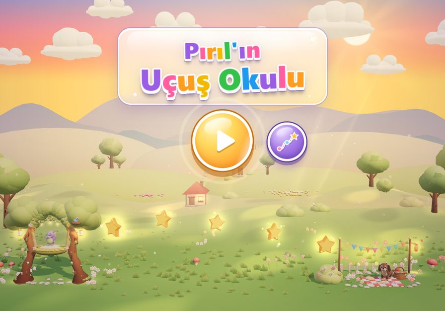
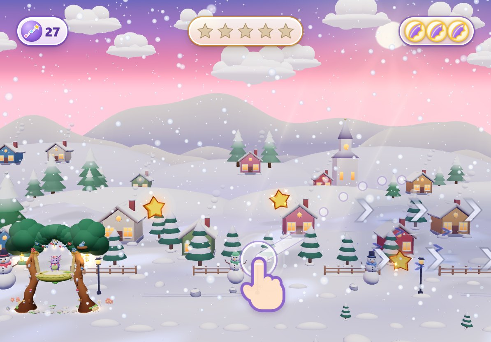
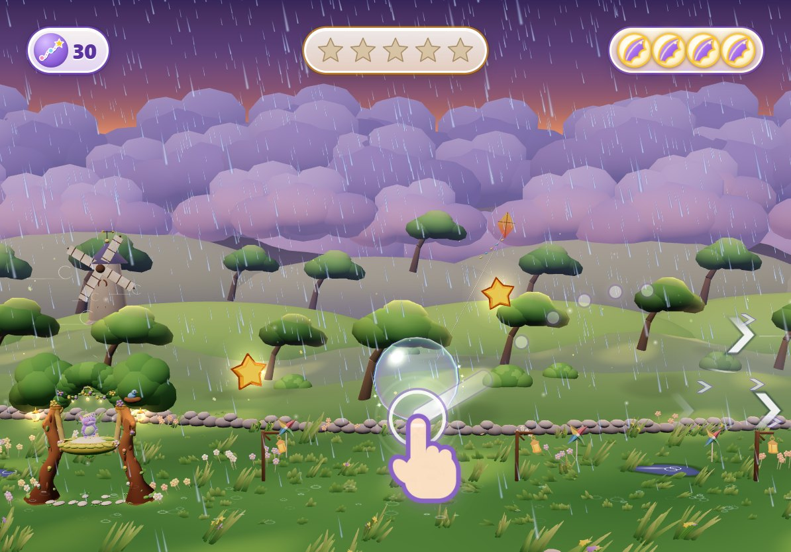
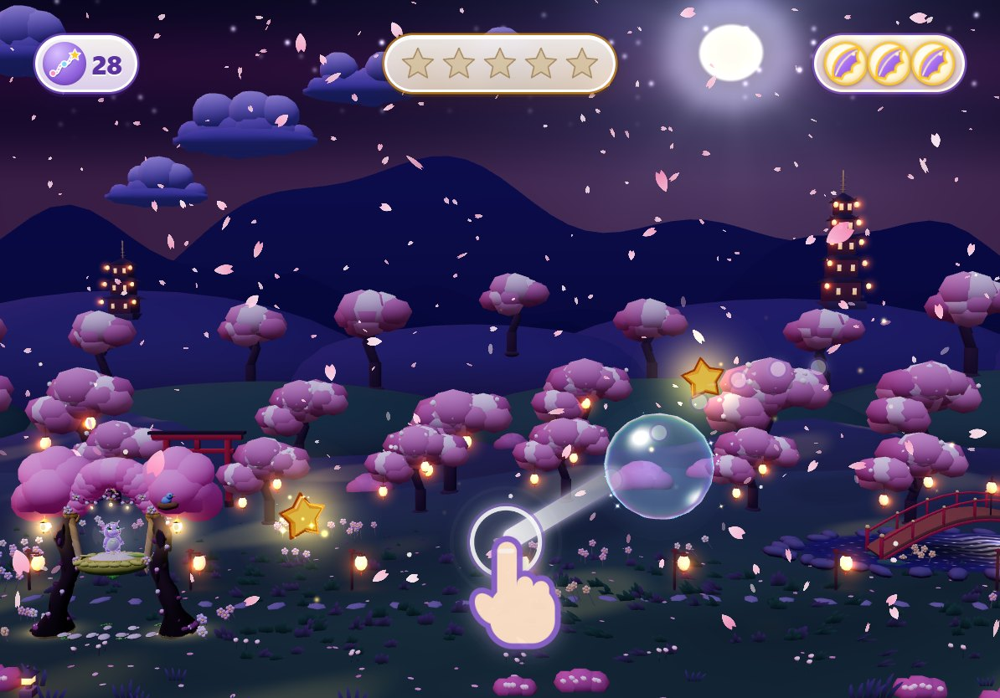
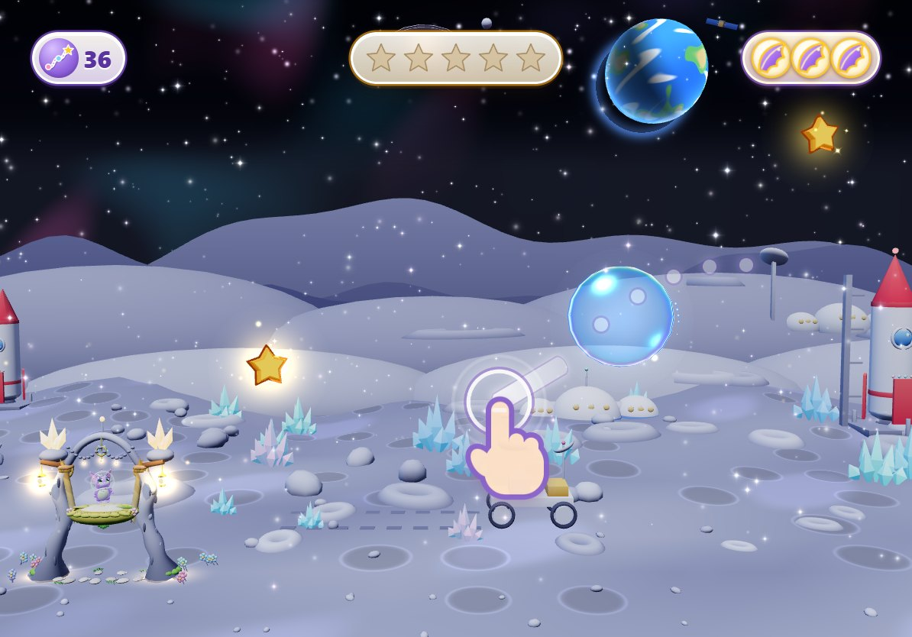
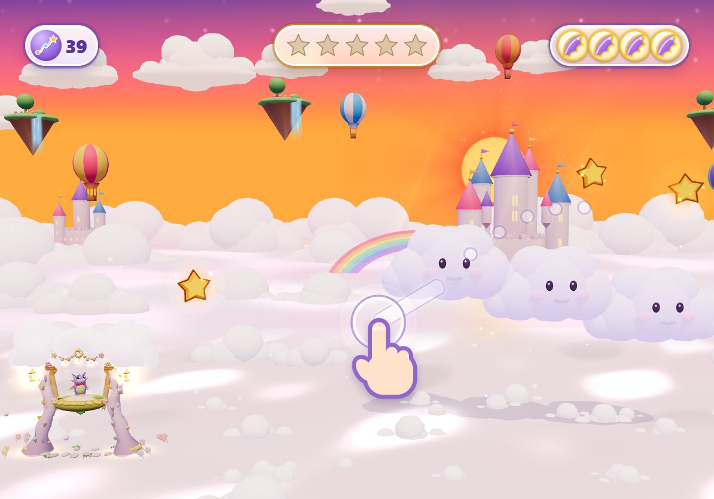
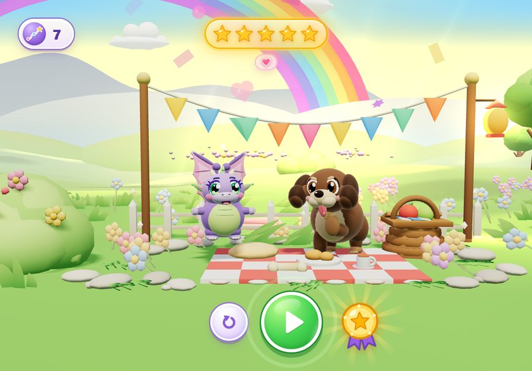

# Pırıl'ın Uçuş Okulu 🐉⭐

5 yaşındaki Feza için yapılmış, masal kitabı tarzında bir uçuş oyunu. Mor bebek ejderha **Pırıl** uçmayı yeni öğreniyor:
iki ağaç arasındaki yaprak salıncaktan fırlıyor, yıldızları topluyor ve çayırın öbür ucunda piknik örtüsünde bekleyen köpeği
**Bilbo**'ya kavuşuyor. 50 bölüm var; yağmurlu ormandan karlı köye, su altı krallığından gökkuşağı karnavalına her biri başka bir yerde geçer. Kaybetmek yoktur: Pırıl ıskalarsa çimene yuvarlanır, silkinir, güler ve salıncağa döner.
Feza okuma bilmediği için her şey resimlerle, simgelerle ve anlatıcının sesiyle anlatılır.

**Oyna:** https://goktugkarpat.github.io/feza-piril-ucus/

## Bölümler

Bölümler patika gibi kıvrılan, parmakla kaydırılan resimli bir **haritada** durur; yolun sonunda Bilbo bekler. Harita başlıktaki mor düğmeden ve oyun içinde
sol üstteki küçük düğmeden açılır. Her bölümün altında kazanılan yıldızlar görünür; kilitli bölüme dokununca yalnızca tatlı bir sallanma olur.

| | Bölüm | | Bölüm |
|---|---|---|---|
| 1 | İlk Uçuş | 21 | Nilüfer Atlamaca |
| 2 | Mantar Trambolini | 22 | Halka Tüneli |
| 3 | İlk Kanat Çırpışı | 23 | Gün Batımı Kanyonu |
| 4 | Yumuşak Bulut Yastığı | 24 | Rüzgâr Merdiveni |
| 5 | Nilüferli Dere | 25 | Büyük Yıldız Şenliği |
| 6 | Lavanta Rüzgârı | 26 | Yağmurlu Orman |
| 7 | Gökkuşağı Halkaları | 27 | Karlı Köy |
| 8 | Çifte Kanat ve Yüksek Uçuş | 28 | Sakura Gecesi |
| 9 | Büyük Parkur | 29 | Çöl Vahası |
| 10 | Yıldızlı Gece Şenliği | 30 | Fırtına Tepesi |
| 11 | Kiraz Çiçeği Bahçesi | 31 | Balkabağı Tarlası |
| 12 | Ayçiçeği Tarlası | 32 | Buzul Gölü |
| 13 | Mercan Kıyısı | 33 | Palmiye Kumsalı |
| 14 | Kristal Vadi | 34 | Sisli Bambu Ormanı |
| 15 | Pamuk Şeker Gökyüzü | 35 | Şeker Diyarı |
| 16 | Akçaağaç Ormanı | 36 | Ay Yüzeyi |
| 17 | Kuzey Işıkları | 37 | Lale Tarlaları |
| 18 | Yüzen Masal Adaları | 38 | Işıldayan Orman |
| 19 | Altın Şafak Tapınağı | 39 | Gök Şatosu |
| 20 | Dev Mantar | 40 | Kış Gecesi Şenliği |
| 41 | Balon Vadisi | 46 | Gökkuşağı Şelalesi |
| 42 | Müzik Çayırı | 47 | Origami Bahçesi |
| 43 | Yel Değirmeni Tepesi | 48 | Deniz Feneri Koyu |
| 44 | Su Altı Krallığı | 49 | Yıldız Gözlemevi |
| 45 | Oyuncak Diyarı | 50 | Büyük Gökkuşağı Karnavalı |

Kanat hakkı bölümlere göre artar: ilk iki bölümde yok, sonra 1, 2, 3 ve en çok 4.

26. bölümden sonrası yeni yerlerdir ve her birinin kendi havası vardır: yağmur, kar, savrulan sonbahar yaprakları, sakura
yaprakları, sis, şeker serpintisi, yıldız tozu. Fırtına Tepesi'nde uzakta yumuşak bir şimşek çakar ve tatlı bir gök gürültüsü
duyulur; Pırıl korkmaz, Bilbo'ya kavuşunca güneş açar ve gökkuşağı çıkar. Pırıl ile Bilbo yere göre giyinir: karda atkı ve bere,
yağmurda sarı şapka, çölde hasır şapka, ayda uzay başlığı.

| | |
|---|---|
|  |  |
|  |  |

Eski bölümlerin de kendi görünüşü vardır: çayır, lavanta tarlası, kiraz bahçesi, mercan kıyısı, kristal vadi, sonbahar ormanı, kuzey ışıklı gece…
Son bölüm havai fişekli büyük bir kutlamayla biter; ardından toplam yıldızları gösteren kupa kartı gelir.

## Yolda Pırıl'a yardım edenler

- **Mantar** — üstüne düşünce yukarı zıplatır.
- **Bulut** — yumuşakça sektirir.
- **Nilüfer** — derenin üstünden atlatır.
- **Rüzgâr** — içinden geçince yukarı taşır.
- **Çiçekli halka** — içinden geçince hızlandırır.
- **Baloncuk** (26. bölümden itibaren) — değince "hop" diye yukarı ve ileri fırlatır.
- **Esinti** (27. bölümden itibaren) — arkadan esen rüzgâr şeridi; içinden geçerken ileri iter.

Her biri ilk kez göründüğü bölümde tek başına ve kolay bir yerde tanıtılır; anlatıcı da bir kez söyler.

## Nasıl açılır

- **İnternette:** https://goktugkarpat.github.io/feza-piril-ucus/
- **iPad'de uygulama gibi (önerilen):**
  1. iPad'de **Safari**'yi aç ve yukarıdaki adrese git.
  2. Üstteki **Paylaş** düğmesine dokun (kutudan çıkan ok).
  3. Listeden **Ana Ekrana Ekle**'yi seç, sonra **Ekle**'ye dokun.
  4. Ana ekranda Pırıl'ın simgesi belirir; ona dokununca oyun tam ekran, uygulama gibi açılır.
  5. Bir kez açıldıktan sonra **internetsiz de çalışır** (uçakta, arabada).
- **Bilgisayarda:** klasördeki `index.html` dosyasına çift tıkla. Kurulum gerekmez.
- **Sessiz açma:** adresin sonuna `?sessiz` ekle.
- **Yeni sürüm gelince:** oyunu kapatıp yeniden aç; internet varken kendiliğinden güncellenir.

## Nasıl oynanır

1. Açılışta büyük turuncu ▶ düğmesine dokun. Oyun kaldığı bölümden devam eder.
2. Parmağını ekranın **herhangi bir yerine** koy, **geriye ve aşağıya doğru çek**, sonra bırak. Ne kadar çok çekersen Pırıl o kadar
   uzağa uçar.
3. Çekerken iri noktalar Pırıl'ın gideceği yolu gösterir. Yolun üstünden geçtiği yıldızlar **parlayıp büyür**: "bu atış bunları alır".
4. 3. bölümden itibaren Pırıl havadayken ekrana dokunursan **kanat çırpar**, yükselir ve kısa süre süzülür. Kaç kanat hakkı olduğu
   sağ üstte resimle görünür.
5. Bilbo'ya kavuşunca kutlama başlar. Yeşil ▶ sonraki bölüme geçer, mor ↻ aynı bölümü bir daha oynatır.
   Beş yıldızın beşi de toplandıysa altın madalya çıkar.

Yıldızlar bölüm içinde **birikir**: Pırıl ıskalasa da, üç yıldızla kavuşup mor ↻ düğmesine basılsa da alınan yıldızlar kalır;
Feza yalnız eksik yıldızları toplar. Beşi tamamlanınca altın madalya çıkar. Beş yıldızın hepsini **tek uçuşta** toplayana ise
gökkuşağı renkli özel madalya verilir; doğru çekiş bulunduğunda bu her bölümde mümkündür.

Pırıl Bilbo'nun biraz önüne ya da arkasına inerse **Bilbo sevinçle ona koşar** ve kavuşma sayılır.

## Ebeveyn için notlar

- **Kaybetmek, süre ya da can yok.** Iskalayınca Pırıl komikçe yuvarlanır ve salıncağa döner; ceza yoktur.
- **Gizli yardım:** art arda denemelerde yıldızlar ve Bilbo, yakından geçen Pırıl'ı biraz daha güçlü çeker; erken ya da geç yapılan kanat dokunuşu da boşa gitmez.
- **Yazı yok:** ekranda oyunun adı dışında sözcük yoktur. İpuçları resimlidir: çekmeyi gösteren el, havada dokunmayı gösteren kanat resmi.
- **Ses:** anlatım doğal bir Türkçe kadın sesiyle önceden kaydedildi (61 kayıt); müzik ve efektler oyunun içinde üretilir.
  Övgü ara sıra ve çeşitlidir.
- **İlerleme iPad'de saklanır:** açılan bölümler ve kazanılan yıldızlar oyunu kapatınca kaybolmaz.
- **Küçük eller için:** sayfa kaymaz, yakınlaşmaz, uzun basınca menü açılmaz; ikinci bir parmak oyunu bozmaz. Yatay ve dikey tutuşta oynanır.
- **Hız:** M1 iPad Pro'da akıcı çalışacak biçimde hafif tutuldu.
- **GitHub'a göndermek:** klasördeki `yayinla.command` dosyasına çift tıkla. Kurulum ve derleme gerekmez; her şey bu klasördedir.

## Yapım

Bu oyun, Feza'nın babası **Göktuğ Karpat** (@goktugkarpat) ile yapay zekâ yardımcıları **Claude Code** (Anthropic), **Codex** (OpenAI) ve **Antigravity** (Google) birlikte çalışarak yapılmıştır.
Fikirler ve kararlar ailenindir; kod, çizimler, bölüm tasarımları ve seslendirme düzenlemeleri bu yardımcılarla birlikte yazılmıştır.
Oyun yalnızca Feza için, kâr amacı olmadan yapılmış bir aile projesidir.
