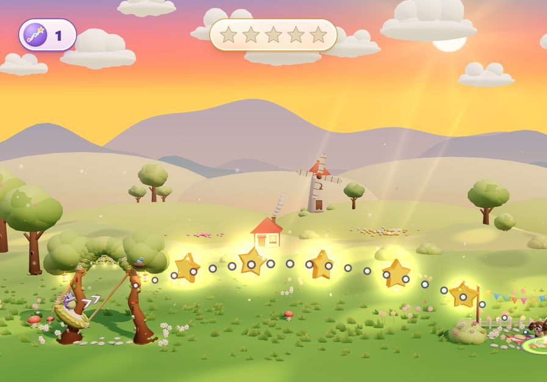
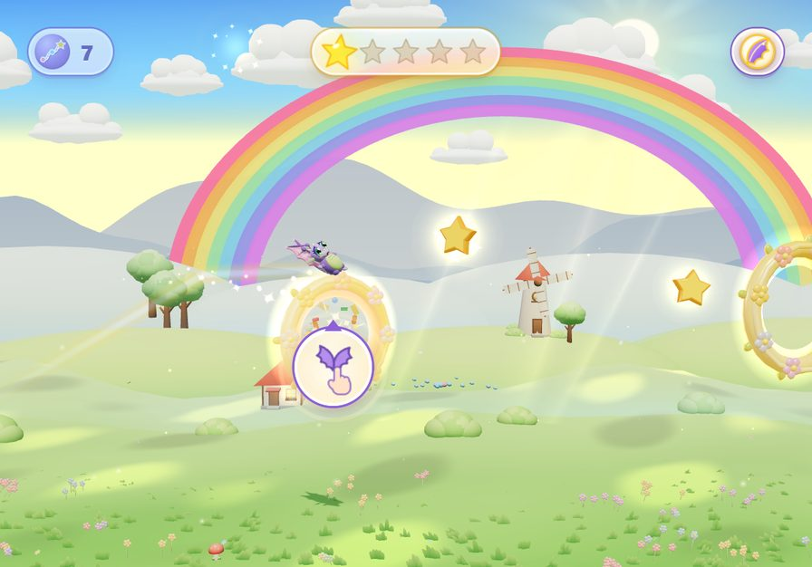
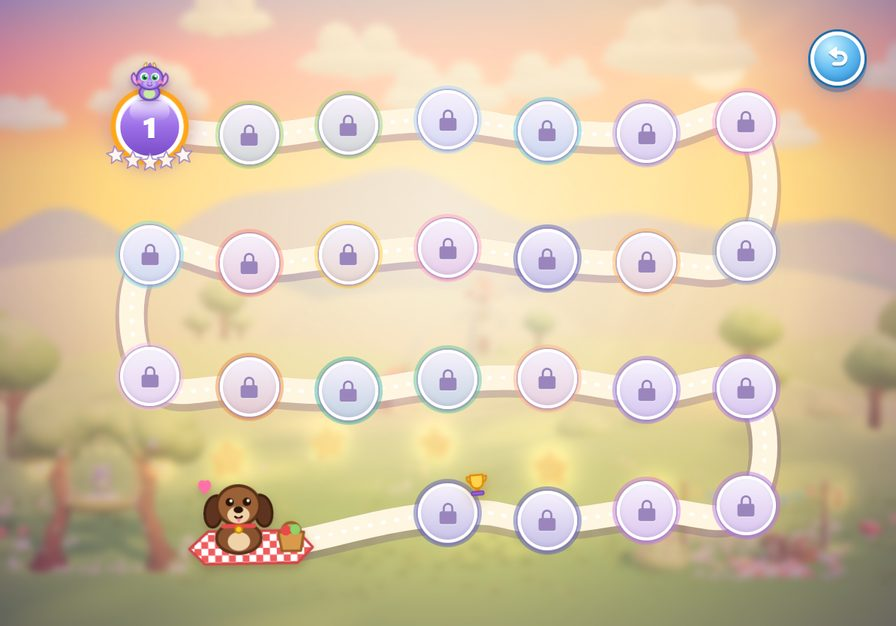

# Pırıl'ın Uçuş Okulu 🐉⭐

5 yaşındaki Feza için yapılmış, masal kitabı tarzında bir uçuş oyunu. Mor bebek ejderha **Pırıl** uçmayı yeni öğreniyor:
iki ağaç arasındaki yaprak salıncaktan fırlıyor, yıldızları topluyor ve çayırın öbür ucunda piknik örtüsünde bekleyen köpeği
**Bilbo**'ya kavuşuyor. 25 bölüm var. Kaybetmek yoktur: Pırıl ıskalarsa çimene yuvarlanır, silkinir, güler ve salıncağa döner.
Feza okuma bilmediği için her şey resimlerle, simgelerle ve anlatıcının sesiyle anlatılır.

**Oyna:** https://goktugkarpat.github.io/feza-piril-ucus/

## Nasıl açılır

- **İnternette:** https://goktugkarpat.github.io/feza-piril-ucus/
- **iPad'de uygulama gibi (önerilen):**
  1. iPad'de **Safari**'yi aç ve yukarıdaki adrese git.
  2. Üstteki **Paylaş** düğmesine dokun (kutudan çıkan ok).
  3. Listeden **Ana Ekrana Ekle**'yi seç, sonra **Ekle**'ye dokun.
  4. Ana ekranda Pırıl'ın simgesi belirir; ona dokununca oyun tam ekran, uygulama gibi açılır.
  5. Bir kez açıldıktan sonra **internetsiz de çalışır** (uçakta, arabada).
- **Bilgisayarda:** klasördeki `index.html` dosyasına çift tıkla. Kurulum gerekmez.
- **Sessiz açma:** adresin sonuna `?sessiz` ekle.
- **Yeni sürüm gelince:** oyunu kapatıp yeniden aç; internet varken kendiliğinden güncellenir.

## Nasıl oynanır

1. Açılışta büyük turuncu ▶ düğmesine dokun. Oyun kaldığı bölümden devam eder.
2. Parmağını ekranın **herhangi bir yerine** koy, **geriye ve aşağıya doğru çek**, sonra bırak. Ne kadar çok çekersen Pırıl o kadar
   uzağa uçar.
3. Çekerken iri noktalar Pırıl'ın gideceği yolu gösterir. Yolun üstünden geçtiği yıldızlar **parlayıp büyür**: "bu atış bunları alır".
4. 3. bölümden itibaren Pırıl havadayken ekrana dokunursan **kanat çırpar**, yükselir ve kısa süre süzülür. Kaç kanat hakkı olduğu
   sağ üstte resimle görünür.
5. Bilbo'ya kavuşunca kutlama başlar. Yeşil ▶ sonraki bölüme geçer, mor ↻ aynı bölümü bir daha oynatır.
   Beş yıldızın beşi de toplandıysa altın madalya çıkar.

Doğru çekiş bulunduğunda her bölümde **tek atışta beş yıldızın hepsi** toplanıp Bilbo'ya kavuşulabilir. Yıldız toplamak isteğe bağlıdır;
Bilbo'ya kavuşmak bölümü bitirmek için yeter.

## Yolda Pırıl'a yardım edenler

- **Mantar** — üstüne düşünce yukarı zıplatır.
- **Bulut** — yumuşakça sektirir.
- **Nilüfer** — derenin üstünden atlatır.
- **Rüzgâr** — içinden geçince yukarı taşır.
- **Çiçekli halka** — içinden geçince hızlandırır.

Her biri ilk kez göründüğü bölümde tek başına ve kolay bir yerde tanıtılır; anlatıcı da bir kez söyler.

## Bölümler

Bölümler patika gibi kıvrılan resimli bir **haritada** durur; yolun sonunda Bilbo bekler. Harita başlıktaki mor düğmeden ve oyun içinde
sol üstteki küçük düğmeden açılır. Her bölümün altında kazanılan yıldızlar görünür; kilitli bölüme dokununca yalnızca tatlı bir sallanma olur.

| | Bölüm | Kanat | | Bölüm | Kanat |
|---|---|---|---|---|---|
| 1 | İlk Uçuş | – | 14 | Kristal Vadi | 3 |
| 2 | Mantar Trambolini | – | 15 | Pamuk Şeker Gökyüzü | 3 |
| 3 | İlk Kanat Çırpışı | 1 | 16 | Akçaağaç Ormanı | 3 |
| 4 | Yumuşak Bulut Yastığı | 1 | 17 | Kuzey Işıkları | 3 |
| 5 | Nilüferli Dere | 1 | 18 | Yüzen Masal Adaları | 3 |
| 6 | Lavanta Rüzgârı | 1 | 19 | Altın Şafak Tapınağı | 3 |
| 7 | Gökkuşağı Halkaları | 1 | 20 | Dev Mantar | 3 |
| 8 | Çifte Kanat ve Yüksek Uçuş | 2 | 21 | Nilüfer Atlamaca | 3 |
| 9 | Büyük Parkur | 2 | 22 | Halka Tüneli | 3 |
| 10 | Yıldızlı Gece Şenliği | 2 | 23 | Gün Batımı Kanyonu | 4 |
| 11 | Kiraz Çiçeği Bahçesi | 2 | 24 | Rüzgâr Merdiveni | 4 |
| 12 | Ayçiçeği Tarlası | 2 | 25 | Büyük Yıldız Şenliği | 4 |
| 13 | Mercan Kıyısı | 2 | | | |

Her bölümün kendi görünüşü vardır: çayır, lavanta tarlası, kiraz bahçesi, mercan kıyısı, kristal vadi, sonbahar ormanı, kuzey ışıklı gece…
Son bölüm havai fişekli büyük bir kutlamayla biter; ardından toplam yıldızları gösteren kupa kartı gelir.

## Ebeveyn notları

- **Kaybetmek, süre ya da can yok.** Iskalayınca Pırıl komikçe yuvarlanır ve salıncağa döner; ceza yoktur.
- **Gizli yardım:** art arda ıskalarda yıldızlar ve Bilbo, yakından geçen Pırıl'ı biraz daha güçlü çeker.
- **Yazı yok:** ekranda oyunun adı dışında sözcük yoktur. İpuçları resimlidir: çekmeyi gösteren el, havada dokunmayı gösteren kanat resmi.
- **Ses:** anlatım doğal bir Türkçe kadın sesiyle önceden kaydedildi (29 kayıt); müzik ve efektler oyunun içinde üretilir.
  Övgü ara sıra ve çeşitlidir.
- **İlerleme iPad'de saklanır:** açılan bölümler ve kazanılan yıldızlar oyunu kapatınca kaybolmaz.
- **Küçük eller için:** sayfa kaymaz, yakınlaşmaz, uzun basınca menü açılmaz; ikinci bir parmak oyunu bozmaz. Yatay ve dikey tutuşta oynanır.
- **Hız:** M1 iPad Pro'da akıcı çalışacak biçimde hafif tutuldu.

## Dosyalar

Kurulum ve derleme gerekmez; her şey bu klasördedir. Çalışma notları `CLAUDE.md` dosyasındadır.
GitHub'a göndermek için klasördeki `yayinla.command` dosyasına çift tıklamak yeter.
